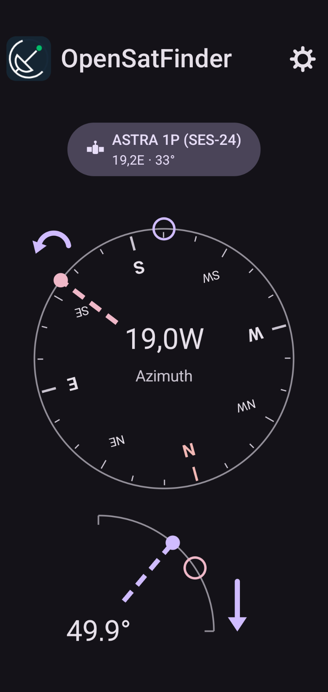
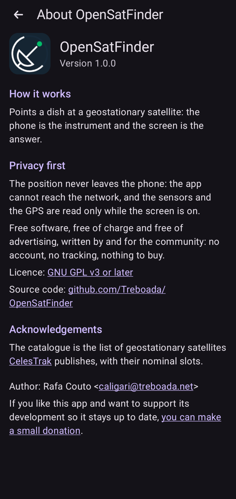

# OpenSatFinder

**Point a satellite dish at a geostationary satellite with your phone.**

<p>
  
  
  
</p>

The phone is the instrument and the screen is the answer. Hold it flat and the
compass shows where the satellite sits and which way to turn; tilt it and the
elevation arc shows how far up in the sky it is. Within two degrees of the target
the needle turns green.

- **Compass and elevation on one screen**, with turn arrows that say which way to go.
- **True north, not just magnetic**, when you grant the location permission.
- **Catalogue of geostationary satellites** with search and favourites, ordered by elevation.
- **No network permission at all**: the position, the sensors and your settings never leave the phone.
- **Free software**: GPL-3.0-or-later, no account, no ads, no tracking.
- **Eight languages**: English, Spanish, Galician, Basque, Catalan, French, German, Portuguese.

## Install

- **GitHub Releases** - download `OpenSatFinder-<version>.apk` from
  [Releases](https://github.com/Treboada/OpenSatFinder/releases) and open it.
- **F-Droid** - the app builds from tags and the listing lives in `fastlane/`; the
  store entry appears once the first release is processed.

Android 7.0 (API 24) or later. The GitHub and F-Droid builds are signed with
different keys, so switching between them means uninstalling first.

## Known limits

- **True north needs a position.** Without the permission or a fix, the bearing stays
  magnetic, and silently so.
- **The declination comes from the platform's world magnetic model**, which ages:
  expect a few tenths of a degree after its epoch.
- **The geometry treats the Earth as a sphere**, which costs a fraction of a degree.
- **The catalogue is a snapshot of nominal slots.** A drifting satellite is not where
  its slot says; satellites launched after the snapshot are missing.
- **A magnetometer is required.** Without one the screen says so instead of drawing a
  believable but meaningless dial.
- **Indoors the first fix can take minutes.** The screen says it is waiting.
- **Portrait only.** Android 16 ignores that on large screens, so a tablet may rotate.

## Buy me a coffee

If you like OpenSatFinder and would like it to keep getting better - and free
software to keep being written this way - you can buy me a coffee at
[Liberapay](https://liberapay.com/caligari/).

Nothing is behind a donation: the app is free of charge, free of ads and free of
tracking for everyone.

## Licence

GNU GPL v3 or later; the full text is in [LICENSE](LICENSE). The app credits
CelesTrak for the satellite catalogue and says where the source lives.

## Contributing

Code, comments, commits and issues are in English. Before sending a change:

```bash
./gradlew :app:testDebugUnitTest :app:lintDebug :app:ktlintCheck
```

Build, tests, translations and the release flow are in [CONTRIBUTING.md](CONTRIBUTING.md).
