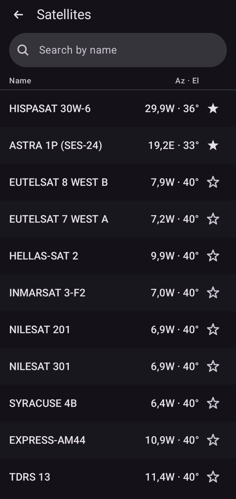

# OpenSatFinder

**Point a satellite dish at a geostationary satellite with your phone.**

<p>
  
  
  
</p>

The phone is the instrument and the screen is the answer. Hold it flat and the
compass shows where the satellite sits and which way to turn; tilt it and the
elevation arc shows how far up in the sky it is. Within two degrees of the target
the needle turns green.

- **Compass and elevation on one screen**, with turn arrows that say which way to go.
- **True north, not just magnetic**, when you grant the location permission.
- **Catalogue of geostationary satellites** with search and favourites, ordered by elevation.
- **No network permission at all**: the position, the sensors and your settings never leave the phone.
- **Free software**: GPL-3.0-or-later, no account, no ads, no tracking.
- **Eight languages**: English, Spanish, Galician, Basque, Catalan, French, German, Portuguese.

## Install

- **GitHub Releases** - download `OpenSatFinder-<version>.apk` from
  [Releases](https://github.com/Treboada/OpenSatFinder/releases) and open it.
- **F-Droid** - the app builds from tags and the listing lives in `fastlane/`; the
  store entry appears once the first release is processed.

Android 7.0 (API 24) or later. The GitHub and F-Droid builds are signed with
different keys, so switching between them means uninstalling first.

## Build

You need JDK 21 and the Android SDK with platform `android-37` and build-tools
`37.0.0`; Android Studio provides both. The committed wrapper downloads Gradle.

```bash
./gradlew :app:assembleDebug      # debug APK
./gradlew :app:testDebugUnitTest  # JVM tests, seconds
./gradlew :app:lintDebug :app:ktlintCheck
./gradlew :app:assembleRelease    # unsigned release APK, what F-Droid builds
```

Instrumented tests (`:app:connectedDebugAndroidTest`) need an emulator or a device.
Versions are pinned in `gradle/libs.versions.toml` and the wrapper; `./gradlew` is
the only Gradle to call.

## Known limits

- **True north needs a position.** Without the permission or a fix, the bearing stays
  magnetic, and silently so.
- **The declination comes from the platform's world magnetic model**, which ages:
  expect a few tenths of a degree after its epoch.
- **The geometry treats the Earth as a sphere**, which costs a fraction of a degree.
- **The catalogue is a snapshot of nominal slots.** A drifting satellite is not where
  its slot says; satellites launched after the snapshot are missing.
- **A magnetometer is required.** Without one the screen says so instead of drawing a
  believable but meaningless dial.
- **Indoors the first fix can take minutes.** The screen says it is waiting.
- **Portrait only.** Android 16 ignores that on large screens, so a tablet may rotate.

## Releasing

1. Bump `versionCode` and `versionName` in `app/build.gradle.kts`, and add
   `fastlane/metadata/android/<locale>/changelogs/<versionCode>.txt` for every
   language (`FastlaneListingTest` fails without it).
2. Tag the commit with the version (`1.0.0`) and publish a GitHub release for it.
   `.github/workflows/release.yml` checks that the tag matches `versionName`, runs
   the tests, builds and signs the APK, and attaches `OpenSatFinder-<version>.apk`.
3. F-Droid builds the same tag and signs it with its own key.

Signing uses four repository secrets: `KEYSTORE_BASE64`, `KEYSTORE_PASSWORD`,
`KEY_ALIAS` and `KEY_PASSWORD`. Create the key once, outside the repository:

```bash
keytool -genkeypair -keystore release.jks -alias opensatfinder \
    -keyalg RSA -keysize 4096 -validity 10000 -dname "CN=OpenSatFinder"
base64 -w0 release.jks > release.jks.b64   # macOS: base64 -i release.jks | tr -d '\n'
```

Keep the keystore and its passwords out of git, and back them up: without the key you
cannot update an installed copy.

## Licence

GNU GPL v3 or later; the full text is in [LICENSE](LICENSE). The app credits
CelesTrak for the satellite catalogue and says where the source lives.

## Contributing

Code, comments, commits and issues are in English. Before sending a change:

```bash
./gradlew :app:testDebugUnitTest :app:lintDebug :app:ktlintCheck
```
